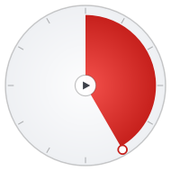

# Circle Timer

A minimal, always-on-top visual timer for Windows — inspired by physical
visual timers. The red disk shrinks counterclockwise as time passes, so you
can grasp the remaining time at a glance, without numbers.

ミニマルな Windows 用ビジュアルタイマー。残り時間が赤い扇形で表示され、
時間の経過とともに反時計回りに減っていきます。数字は表示されません。



## Download

Grab `CircleTimer.exe` from the [latest release](../../releases/latest).
No installation required — it's a single portable executable.

> **Note (SmartScreen):** The exe is not code-signed, so Windows may show a
> "Windows protected your PC" warning on first launch. Click
> **More info → Run anyway**. You can always audit the source code in this
> repository and build it yourself.

## Usage / 使い方

| Action | Result |
|---|---|
| Drag the white handle (or the outer ring) | Set time — clockwise, up to 60 min / 時間セット（1周=60分） |
| Click the center button | Start / pause（開始・一時停止） |
| Double-click | Reset（リセット） |
| Mouse wheel | ±1 min (Ctrl: ±10 sec) |
| Drag anywhere else | Move the window（ウィンドウ移動） |
| Right-click | Menu: always-on-top, opacity 25–100%, size, quit（前面表示・透過度・サイズ・終了） |
| `Space` / `R` | Start-pause / reset |

The handle can be dragged **while the timer is running** to extend time.
Settings (duration, opacity, position, size) are saved automatically.

- While idle, the internal timer is fully stopped — near-zero CPU usage.
- Flashes red and beeps when time is up.

## Build from source

```
pip install PySide6 pyinstaller
pyinstaller --onefile --windowed --name CircleTimer --icon icon.ico timer.py
```

Or just run it directly: `python timer.py` (Python 3.10+, PySide6).

## License

[MIT](LICENSE)
